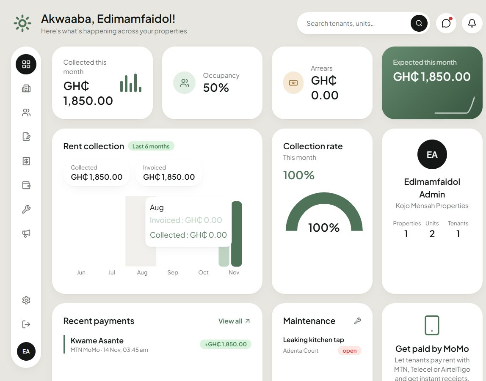
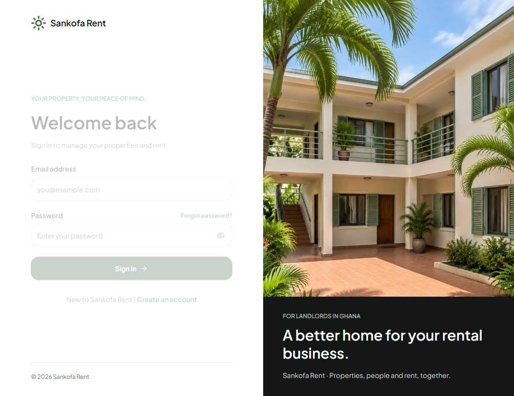
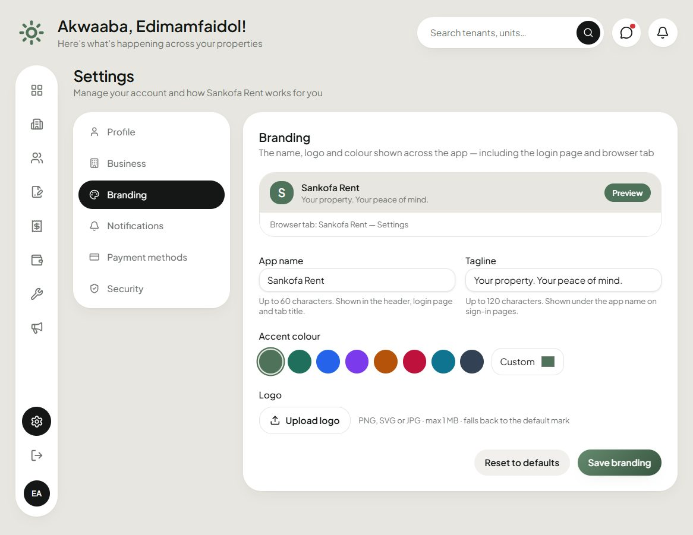

<div align="center">

# ☀ Sankofa Rent

### Rent, handled beautifully.

### Made for Ghanaian landlords.

Property management, rent invoicing, payments and receipts — one calm dashboard.<br/>
Built as a university final-year project by **Edith Nonnon**, engineered like a product launch.

<a href="https://final-year-rent-project.edimamfaidol.workers.dev"></a>

[](https://www.typescriptlang.org/)
[](https://react.dev/)
[](https://tanstack.com/start)
[](https://convex.dev/)
[](https://tailwindcss.com/)
[](https://www.framer.com/motion/)
[](https://workers.cloudflare.com/)

</div>

<br/>

<div align="center">



</div>

---

## Why Sankofa Rent

Rent collection in Ghana still runs through WhatsApp groups, exercise books and scattered MoMo receipts. Property managers can't see their occupancy, lagging tenants or monthly collection at a glance — and owners need proof of payment, not screenshots.

Sankofa Rent gives a single landlord everything: **properties and units, tenants and leases, rent invoices with due dates, in-app payments (MoMo + bank + cash), digital receipts, maintenance requests, announcements and a monthly dashboard** — in English, with pesewas-exact money handling, styled for the Ghanaian market.

It works equally well on the phone in a landlord's pocket and the laptop on their desk. And because it's a final-year defence piece, the whole product is **rebrandable live** — name, tagline, logo and accent colour — all changeable from Settings by the admin in front of the panel.

---

## Features

|                         |                                                                                    |
| ----------------------- | ---------------------------------------------------------------------------------- |
| **Dashboard**           | Collected vs invoiced, collection rate, occupancy, arrears — last 6 months         |
| **Properties & units**  | One-tap property + unit management, rent roll, occupancy KPIs                      |
| **Tenants**             | Profiles, unit assignment, balances derived from unpaid invoices                   |
| **Leases**              | Create / renew / end; duplicate-safe unit assignment                               |
| **Invoices**            | Draft → send → paid; monthly generation cron; duplicate guard                      |
| **Payments & receipts** | MoMo (MTN, Telecel, AirtelTigo), bank, cash — numbered receipts                    |
| **Maintenance**         | Priority + status tracking per unit                                                |
| **Announcements**       | In-app Tenant Notice Board (`/notices`) with property targeting & urgent pinning   |
| **Accounts & Admins**   | Multi-admin support, promote/demote, password resets, account provisioning         |
| **Branding**            | Admin-only: live app name, tagline, 8 curated accents + custom colour, logo upload |
| **Roles**               | First account on a deployment becomes admin, the rest members                      |
| **Mobile-native**       | iOS translucency, Android M3 ripple + pill, page transitions, platform detection   |
| **Dark mode**           | Full OKLCH token set; OS preference + manual toggle                                |

---

## Screenshots

<div align="center">

**Sign in** — split-screen with courtyard photography


**Live rebranding** — Settings → Branding (admin-only)


</div>

---

## Tech stack

| Layer     | Choice                                                                     |
| --------- | -------------------------------------------------------------------------- |
| Framework | **TanStack Start** (SSR React 19, file-based routes) + TanStack Query      |
| Backend   | **Convex** — schema, queries, mutations, crons, file storage               |
| Auth      | **@convex-dev/auth 0.0.98** — email + password                             |
| Styling   | **Tailwind CSS v4** — OKLCH tokens, `@utility` custom utilities, dark mode |
| Animation | **Framer Motion 14** — page transitions, Android M3 pill, More drawer      |
| Charts    | **Recharts 2** — 6-month bar chart, collection gauge                       |
| Money     | Integer pesewas (GH₵ 1 = 100 p) — never floats                             |
| Deploy    | **Cloudflare Workers** (Nitro `cloudflare-module`), CI as npm-only         |
| Tests     | **Vitest 4** + Testing Library — 20 unit tests                             |

---

## Mobile experience

The app is fully native-feel on phones. Key implementation:

- **Platform detection** (`use-platform.ts`) — stamps `data-platform="ios|android|other"` on `<html>` at mount; drives platform-specific CSS and rendering decisions.
- **iOS** — translucent tab bar (`backdrop-filter: saturate(180%) blur(20px)`); centred navigation title; filled tab icons on active.
- **Android** — Material 3 animated pill indicator (Framer Motion `layoutId` spring); ripple on tap (`use-ripple.ts`); haptic feedback via `navigator.vibrate`.
- **Page transitions** — `AnimatePresence` wraps the main content area; 150 ms ease-out fade + 6 px Y slide.
- **Safe areas** — CSS variables `--sat`/`--sab`/etc. from `env(safe-area-inset-*)`, applied to top bar, bottom nav, and save bars.
- **Keyboard** — `visualViewport` listener adjusts main content margin when the soft keyboard appears.
- **iOS input zoom prevention** — `text-base` throughout; `md:text-sm` removed from the Input component.

---

## Design system

- **OKLCH tokens** in `styles.css` for all colours — light and dark mode, no hard-coded hex in component code.
- **Typography** — Plus Jakarta Sans (web); system fonts on mobile; `clamp()` sizes on KPI numbers.
- **Staggered entrance** — `stagger-children` Tailwind utility for list entrance animation; respects `prefers-reduced-motion`.
- **Browser surfaces** — `caret-color`, `::selection`, and scrollbars are all themed from the token set.
- **Error states** — pill banners using `bg-destructive-soft`/`bg-primary-soft`; no `border-left` accent stripes.
- **Automated audit** — impeccable design detector run against all UI files: **0 findings**.

---

## Quick start

Prerequisites: **Node.js ≥ 22** and **npm** (no bun/pnpm/yarn).

### 🚀 Universal NPM Quick Start (Cross-Platform)

Works on any OS (Windows, macOS, Linux) without needing batch files or shell permissions:

```sh
# 1. Clone repository
git clone https://github.com/BRIGHTEDUFUL/sankofa-rent.git
cd sankofa-rent

# 2. Install dependencies
npm install

# 3. One-step setup (auto-creates .env.local and syncs Convex backend)
npm run setup

# 4. Run the full stack (Convex backend + Vite frontend in one command)
npm run dev:full
```

Your app will start at `http://localhost:3000`!

---

### Alternative: Run in Separate Terminals

If you prefer separate terminal windows for backend and frontend:

```sh
# Terminal 1 — Convex backend watcher
npm run dev:backend

# Terminal 2 — Vite frontend
npm run dev
```

---

### One-Click Script Run (Windows & Unix)

If you prefer double-clicking a script:

1. **On Windows:** Run:
   ```cmd
   run.bat
   ```
2. **On Mac/Linux:** Run:
   ```sh
   chmod +x run.sh && ./run.sh
   ```

> **What `run.bat` does automatically:**
>
> - Checks Node.js installation
> - Auto-generates `.env.local` with the backend keys
> - Installs all `npm` dependencies
> - Runs all 20 test suites to verify integrity
> - Starts the Convex backend sync
> - Starts Vite on `http://localhost:3000` and automatically opens your browser!

---

### Manual Setup (Optional)

### Set up environment files

The repo ships `.env.production` (public, committed). You need **one local file** for dev:

Create **`.env.local`** in the project root:

```env
CONVEX_DEPLOYMENT=dev:adorable-pig-437
CONVEX_DEPLOY_KEY=<your-convex-deploy-key>
VITE_CONVEX_URL=https://adorable-pig-437.convex.cloud
VITE_CONVEX_SITE_URL=https://adorable-pig-437.convex.site
```

> **Don't have the deploy key?** Ask the project author, or create your own free Convex project at [dashboard.convex.dev](https://dashboard.convex.dev) and replace the deployment names above with yours.

### Run locally

```sh
# Terminal 1 — sync backend functions to Convex
npx convex dev

# Terminal 2 — start the frontend dev server
npm run dev        # → http://localhost:3000
```

Create your first account — the first sign-up on a fresh deployment becomes the admin.

### Verify everything works

```sh
npm test           # 20 tests across 4 files — all must pass
npm run lint       # 0 errors (11 warnings in vendor files are normal)
npm run build      # production build — must exit cleanly
```

---

## Scripts

| Command                                              | What it does                                   |
| ---------------------------------------------------- | ---------------------------------------------- |
| `npm run dev`                                        | Vite dev server (SSR) on port 3000             |
| `npx convex dev`                                     | Push schema/functions to dev, regenerate types |
| `npx convex deploy --env-file .env.production.local` | Push backend to prod                           |
| `npm test`                                           | Vitest (20 tests, 4 files)                     |
| `npm run lint`                                       | ESLint — 0 errors                              |
| `npm run build`                                      | Production build → `.output/` (Nitro)          |
| `npm run format`                                     | Prettier — auto-format all files               |

---

## Deployments

| Environment    | URL                                                          | Convex deployment         |
| -------------- | ------------------------------------------------------------ | ------------------------- |
| **Production** | **https://final-year-rent-project.edimamfaidol.workers.dev** | `prod:usable-penguin-827` |
| Development    | localhost:3000                                               | `dev:adorable-pig-437`    |

Backend and frontend deploy separately. The frontend auto-deploys to Cloudflare Workers on every push to `main` (Workers Builds). The backend deploys on demand with `npx convex deploy --env-file .env.production.local`.

The production backend is pre-seeded with a small, real dataset (1 property · 2 units · 1 tenant · 1 paid invoice · 1 receipt · 1 maintenance request · 1 announcement).

---

## Project structure

```
convex/            Backend: schema, auth, functions, crons, operator migrations
src/
  components/      AppShell (Card/Button/Badge), AuthLayout, DataPage, FormDialog, Radix UI
  hooks/           use-platform.ts, use-ripple.ts, use-mobile.ts
  lib/             BrandingProvider, convex client, format utilities, haptics
  routes/          TanStack file-routes: /, /properties, /tenants, /leases,
                   /invoices, /payments, /maintenance, /announcements, /settings,
                   /login, /signup, /forgot-password
  styles.css       Tailwind v4 source: OKLCH tokens, utilities, platform CSS, dark mode
docs/              Project report + CONVEX_MIGRATION.md + screenshots
public/            favicon.svg, manifest.webmanifest, icons, robots.txt
```

---

## Engineering highlights

- **Full-stack branding, done properly** — a public singleton table drives a `BrandingProvider`; the React tree, `document.title`, the favicon `link` and the `--primary` CSS variable all re-skin live, with a `MutationObserver` guard that prevents infinite title-rewrite loops.
- **Server-enforced roles** — UI hides `Settings → Branding` for members, but the write path throws `Admin access required` server-side. UI gates are never authorization.
- **Native-feel mobile** — platform detection, iOS translucency, Android M3 ripple and animated pill, page transitions, keyboard offset — all without a native build.
- **Pesewas-safe money, friendly errors** — `GH₵ 1,850.00` renders correctly; a Convex `Uncaught Error` becomes "Invoice INV-1001 already covers this lease and period".
- **Sign-out is bulletproof** — a hard reload recreates the module-level Convex client instead of leaving stale websocket state behind.
- **Zero anti-patterns** — an automated design detector found 0 issues after the final design sweep (banned side-tab borders, decorative sparklines, and eyebrow kickers were all removed).
- **20/20 unit tests** on branding validation, the cedi parser, auth rules and routing; zero console errors in production.

---

## Docs and report

- **[Final-Year Project Report](docs/FINAL_YEAR_PROJECT.md)** — full write-up: objectives, scope, functional/non-functional requirements, architecture, data model, mobile architecture, design system, implementation, test evidence, deployment, limitations.
- **[Convex migration runbook](docs/CONVEX_MIGRATION.md)** — schema walk-through, auth wiring, deployment pipelines, operator commands.
- **[Backend map](convex/README.md)** — one function file per domain.

---

## Roadmap

- [x] Live on Cloudflare Workers (`final-year-rent-project`)
- [x] Custom branding (name · tagline · logo · accent) with admin enforcement
- [x] Roles (admin / member), first-account-becomes-admin
- [x] Multi-admin support & full Account Management interface (`Settings → Accounts`)
- [x] Full mobile-native experience: iOS translucency, Android M3, platform detection, page transitions, keyboard offset, safe areas
- [x] Design system & accessibility sweep: OKLCH tokens, 44 px unified touch targets, themed selects, zero anti-patterns
- [x] Dark mode (OS preference + manual toggle)
- [ ] Password-reset emails (Resend)
- [ ] SMS / WhatsApp rent reminders (Arkesel/mNotify)
- [ ] MoMo collection webhooks (MTN/Telecel/AirtelTigo)
- [ ] Rotate demo admin password after submission

---

## Author

**Edith Nonnon** — Final-Year Project, 2026.

---

## License

University final-year project · Sankofa Rent · 2026. Brand assets belong to the author.
