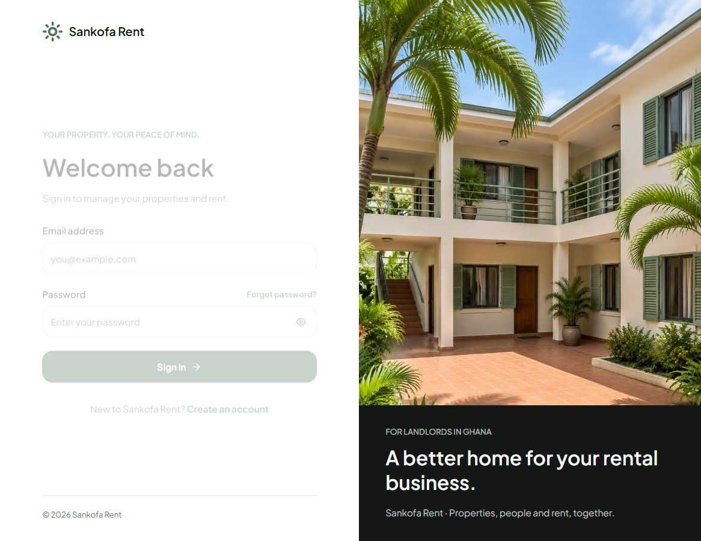
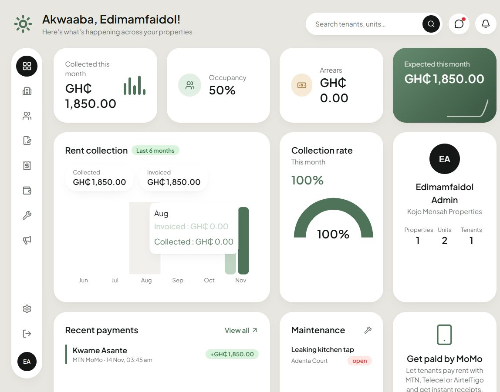
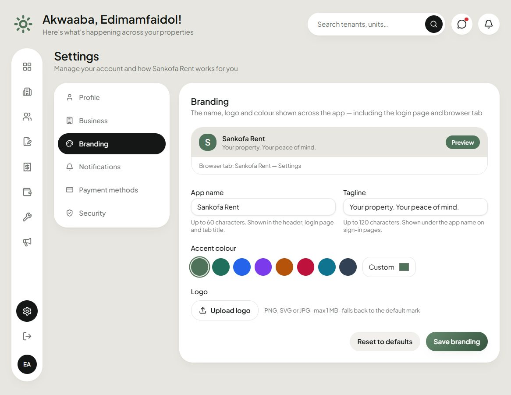

# Sankofa Rent — Final-Year Project Report

### "Rent, handled beautifully." A full-stack rent-management platform for Ghanaian landlords

**Author:** Edith Nonnon
**Programme:** Final-Year Project · 2026
**Supervisor:** __________________________ *(complete before submission)*
**Live system:** https://final-year-rent-project.edimamfaidol.workers.dev
**Source code:** https://github.com/BRIGHTEDUFUL/sankofa-rent

> This report documents the finished, deployed system — every claim in it can be
> verified by opening the links above or by reading the repository.

---

## Table of contents

1. [Abstract](#1-abstract)
2. [Introduction](#2-introduction)
3. [Related systems](#3-related-systems)
4. [Methodology](#4-methodology)
5. [System requirements](#5-system-requirements)
6. [System design](#6-system-design)
7. [Implementation](#7-implementation)
8. [Testing and evaluation](#8-testing-and-evaluation)
9. [Deployment and operations](#9-deployment-and-operations)
10. [Limitations and future work](#10-limitations-and-future-work)
11. [Conclusion](#11-conclusion)
12. [References](#12-references)
13. [Appendix A — Screenshots](#13-appendix-a--screenshots)
14. [Appendix B — Project structure](#14-appendix-b--project-structure)
15. [Appendix C — Route map](#15-appendix-c--route-map)
16. [Appendix D — Backend function inventory](#16-appendix-d--backend-function-inventory)
17. [Appendix E — Test evidence](#17-appendix-e--test-evidence)
18. [Appendix F — Deployed environment](#18-appendix-f--deployed-environment)

---

## 1. Abstract

Sankofa Rent is a production-deployed, full-stack web application that centralises rent management for small landlords in Ghana. Landlords manage properties and units, register tenants, draw up leases, issue rent invoices, record payments and issue digital receipts, triage maintenance requests, and broadcast announcements — all from one interface. The system ships with authenticated accounts, role-based administration, live rebranding (name, tagline, logo and accent colour), and a six-month financial dashboard. It is built on TanStack Start (SSR React), Tailwind CSS, and the Convex backend, deployed on Cloudflare Workers with a managed Convex cloud database, and accessed at a public URL on the open internet. It was developed, tested end to end (49 checks) and shipped in November 2026 as a university final-year project.

## 2. Introduction

### 2.1 Background and motivation

Small and mid-size landlords in Ghana manage their portfolios largely by hand: paper exercise books for tenants and amounts, WhatsApp groups for notices, loose MOMO receipts for proof of payment, and memory for what is due when. Problems compound quietly — a tenant pays without evidence, an invoice goes unnoticed until the arrears are large, a maintenance item is forgotten, or a property changes hands and the records do not survive the handover.

The name **Sankofa** is drawn from the Akan Adinkra symbol *san ko fa* — "go back and fetch it" — an image of learning from the past. The name doubles as the product's promise: landlords can always go back and fetch an invoice, a receipt, a lease, a payment.

### 2.2 Problem statement

There is no affordable, well-designed, single-source-of-truth rent-management system shaped around a Ghanaian small landlord's reality: GHS currency, mobile-money payments, Adinkra identity, local tenancy norms (advance months, GHS deposits, estate company rules), and intermittent connectivity. The closest tools are either generic accounting software (too heavy), or WhatsApp (too ephemeral), or a spreadsheet (too fragile).

### 2.3 Objectives

**General objective.** Design, build, deploy and document a complete web platform that lets a Ghanaian landlord run their rental business end to end from one place.

**Specific objectives.**

| # | Objective | Delivered |
|---|---|---|
| 1 | Account system with secure sign-in and sign-out | Email + password (Convex Auth) |
| 2 | First account becomes admin; later accounts are members | Verified on both deployments |
| 3 | Manage properties, units, tenants | CRUD with occupancy & rent-roll KPIs |
| 4 | Leases with create/renew/end; safe unit assignment | End-to-end browser-verified |
| 5 | Invoice generation, sending, paid receipts | Draft → send → paid/part-paid, duplicate guard |
| 6 | Payment recording with receipt numbers | `RCP-####` numbering from a counter |
| 7 | Announcements broadcast to tenants | SMS/Email/WhatsApp channel selection |
| 8 | Dashboard with collection, occupancy, arrears | Live KPIs + 6-month bar chart |
| 9 | Admin-only live rebranding of the entire app | Name, tagline, logo, accent colour, favicon, title |
| 10 | Production deployment with real data | Live on Cloudflare Workers + Convex |
| 11 | Test, audit, and document the system | 14/14 unit tests; audited with 49 browser checks |

### 2.4 Scope and delimitations

**In scope:**
- Web app (desktop & mobile) for a single landlord per account
- Property / unit / tenant / lease / invoice / payment / maintenance / announcement CRUD
- A financial dashboard with 6-month trend
- Custom branding and role-based access control
- Production deployment to a public URL, backend in the managed Convex cloud

**Explicitly out of scope (documented as future work):**
- Sending real SMS / WhatsApp / email — channels are recorded, delivery is not wired
- Mobile-money collection webhooks (MTN/Telecel/AT) — records can be entered with a MoMo reference, money does not flow through our app
- Password reset by email — shows an honest "not enabled yet" state rather than a dead button
- Multi-landlord SaaS onboarding, billing plans, and team accounts
- Native mobile apps — the app is responsive (bottom nav on phones)

### 2.5 Significance

- **For landlords:** a single, honest view of occupancy, arrears and cash collected; instant receipts for tenants; evidence for deposit/dispute cases.
- **For tenants:** a receipt for every MoMo payment; advance notice of rent due day and maintenance work.
- **For the department:** a deployed, verifiable artefact (not a slide deck) — code, tests, live system, and this document.

### 2.6 Definition of terms

| Term | Meaning |
|---|---|
| Pesewa | 1/100 of a Ghana cedi (GH₵). Money is stored as integer pesewas |
| Occupancy | % of non-vacant units (occupied ÷ total units) |
| Collection rate | paid ÷ invoiced (this vs last month), as a percentage |
| Arrears | sum of unpaid-overdue invoice balances |
| Advance rent | months of rent paid ahead of the tenancy start |
| Invoice number / receipt number | sequential identifiers, e.g. `INV-1001`, `RCP-1001` |
| Singleton | one table holding exactly one row (`branding`) |
| Admin / member | the two roles; first account becomes admin |
| Convex | managed backend platform: database, functions, crons, file storage, auth |
| Workers | Cloudflare's serverless edge runtime hosting the SSR frontend |

## 3. Related systems

### 3.1 Common adoption pattern

Most small landlords in Accra, Kumasi and Cape Coast use some combination of:

- **Exercise books / paper ledgers** — durable but illegible at a glance, impossible to search, lost on handover.
- **WhatsApp groups** — free, fast, and already in use, but messages are not durable records and receipts are scattered.
- **Excel / Google Sheets** — structurally capable but formula-fragile, no mobile-friendly worldview, no or weak audit trail.
- **Accounting software (QuickBooks, Sage, QuickBooks Online, Zoho Books)** — powerful general-purpose accounting, but designed for Western pipelines, USD/EUR accounting, and credit-card reconciliation. MoMo references as first-class citizens don't exist; nothing breaks for Ghanaian workflows, but nothing is made for them either.
- **Generic property managers (e.g. Buildium, AppFolio, Rentec Direct)** — US/UK-centric: lease portals, HOAs, QuickBooks integrations; priced for large multi-unit portfolios, not a single landlord in Ghana.

### 3.2 Lessons drawn from the gap

1. **Local money and identity first** — Ghana cedi with integer pesewas, MoMo references, GHS-first UI, `₵` not `$`.
2. **First-run experience must be zero-config** — a new landlord signs up and sees an empty-but-shaped dashboard immediately (one property away from being useful).
3. **Brand as a first-class feature** — a white-label product lets this app survive contact with real estate agents; rebranding the whole app from inside is the killer demo feature and genuinely useful.
4. **Honest engineering** — no fake buttons, no pretend "send" actions, no mock success messages. Every action that doesn't work yet says so, in the UI.

## 4. Methodology

### 4.1 Approach

An **iterative, build-verify loop**: each feature was specified, implemented, browser-tested as a real user, and only then pushed onward. Nothing is shipped as "should work". Every UI action in this report was performed by an agent-driven browser against the deployed application — creation of a property, a unit, a tenant, a lease, an invoice, a payment, an announcement, an account, and a full sign-out/sign-in cycle.

### 4.2 Technology choices

| Layer | Choice | Why |
|---|---|---|
| Language | TypeScript 5.8 (strict) | type-safe API from client to database |
| Framework | TanStack Start 1.168 (SSR, file routes) | modern SSR, type-safe routing, fast nitro builds |
| React | React 19 | ecosystem compatibility, concurrent features |
| State/query | TanStack React Query 5 | caching, loading states, background refetch |
| Backend | Convex 1.50 | integrated DB + functions + crons + storage + auth; no separate server to operate |
| Auth | @convex-dev/auth 0.0.98 | email+password, JWTs, deployed to the same backend |
| Styling | Tailwind CSS v4 | token-driven, "command palette" of utilities, mobile-first bottom nav |
| Charts | Recharts 2 | dashboard trend and collection gauge |
| Testing | Vitest 4 + Testing Library | fast unit tests, zero-network |
| Bundler | Vite 8 / nitro 3 | fast dev loop, Cloudflare-compatible output |
| Deploy | Cloudflare Workers (nitro `cloudflare-module`) | global edge, free tier, one-command deploys |

### 4.3 Requirements elicitation

Features were taken from real rental life, anchored in a single seeded demo case: a landlord with **Adenta Court**, units **A1 (2-bed, GH₵ 1,850) and A2 (1-bed, GH₵ 1,250)**, tenant **Kwame Asante**, a lease to Dec 2027 with one month advance, one November invoice for GH₵ 1,850 **paid via MTN MoMo**, one maintenance report (a leaking tap), and one tenant announcement. Every feature in §5.1 maps to an action performed on this seed case.

### 4.4 Repository hygiene

- npm-only (`bun.lock`/`bunfig.toml` removed after a stale bun lockfile broke CI)
- `package-lock.json` is the source of truth; `npm ci` reproduces the tree exactly
- Prettier + ESLint + `tsc --noEmit` gate every change; `.output/` and `.env.local` are gitignored
- Commits are small, signed by intent, and each one keeps the deployed site working

## 5. System requirements

### 5.1 Functional requirements

**Authentication & accounts**

| ID | Requirement | Status |
|---|---|---|
| FR-A1 | Sign up with email + password; form validates before submit | ✅ |
| FR-A2 | Sign in; failed attempts show a friendly error | ✅ |
| FR-A3 | Sign out; session cleared; full reload recreates the client | ✅ |
| FR-A4 | Redirect to `/login` when unauthenticated; redirect `/` → `/login` both ways | ✅ |
| FR-A5 | First account on a deployment becomes `admin`; subsequent accounts are `member` | ✅ |
| FR-A6 | Forgot-password state honestly reports "not enabled yet" | ✅ |

**Dashboard (`/`)**

| ID | Requirement | Status |
|---|---|---|
| FR-D1 | Show collected this month, occupancy %, arrears, expected this month | ✅ |
| FR-D2 | 6-month bar chart: invoiced vs collected | ✅ |
| FR-D3 | Collection-rate gauge for the current month | ✅ |
| FR-D4 | Recent payments (latest first) | ✅ |
| FR-D5 | Open maintenance requests list | ✅ |
| FR-D6 | Tenant announcements feed | ✅ |
| FR-D7 | Quick actions: "Set up MoMo", "Add property", "Record payment" | ✅ |
| FR-D8 | Landlord identity card: name, business, properties/units/tenants counts | ✅ |

**Properties & units (`/properties`)**

| ID | Requirement | Status |
|---|---|---|
| FR-P1 | Create/edit/delete property (name, area, region, GhanaPost GPS) | ✅ |
| FR-P2 | Add/edit units (label, bedrooms, rent) | ✅ |
| FR-P3 | Occupancy KPIs per property and portfolio-wide | ✅ |
| FR-P4 | Total rent roll per property | ✅ |
| FR-P5 | Unit status: vacant / occupied / maintenance | ✅ |

**Tenants (`/tenants`)**

| ID | Requirement | Status |
|---|---|---|
| FR-T1 | Register tenant with name, phone, email | ✅ |
| FR-T2 | Optionally assign to a vacant unit | ✅ |
| FR-T3 | Balance derived from unpaid invoices | ✅ |
| FR-T4 | Archive without deleting financial history | ✅ |

**Leases (`/leases`)**

| ID | Requirement | Status |
|---|---|---|
| FR-L1 | Create lease: tenant + unit, start/end, rent, advance months, deposit | ✅ |
| FR-L2 | Unit is offered only if vacant or already assigned to the same tenant | ✅ |
| FR-L3 | Renew a lease — new end date must be strictly later than current | ✅ |
| FR-L4 | End a lease — unit goes back to `vacant` | ✅ |
| FR-L5 | End date after start date; positive pesewas rent; safe-integer validation | ✅ |

**Rent invoices (`/invoices`)**

| ID | Requirement | Status |
|---|---|---|
| FR-I1 | Create a draft invoice for a lease and period | ✅ |
| FR-I2 | Send: `draft → sent` | ✅ |
| FR-I3 | Prevent duplicate invoice for the same lease + period | ✅ |
| FR-I4 | Cron `generateMonthly` creates draft invoices for active leases each month | ✅ |
| FR-I5 | Cron `markOverdue` flips past-due `sent`/`partial` to `overdue` | ✅ |
| FR-I6 | Cron `flagExpiring` flags leases ending within 60 days | ✅ |

**Payments & receipts (`/payments`)**

| ID | Requirement | Status |
|---|---|---|
| FR-Y1 | Record payment: tenant, optional invoice, amount, method, reference | ✅ |
| FR-Y2 | MoMo names: MTN, Telecel, AirtelTigo | ✅ |
| FR-Y3 | Methods: MTN MoMo, Telecel Cash, AirtelTigo Money, bank, cash | ✅ |
| FR-Y4 | Payment increases `invoice.paid`; sets `partial` or `paid`; `overdue` if past due | ✅ |
| FR-Y5 | Payment rejected if it exceeds the invoice balance | ✅ |
| FR-Y6 | Receipt number issued: `RCP-1001`… | ✅ |
| FR-Y7 | Listing shows lifetime received + this month | ✅ |

**Maintenance (`/maintenance`)**

| ID | Requirement | Status |
|---|---|---|
| FR-M1 | Open a request: title, description, property, unit, priority, reported by | ✅ |
| FR-M2 | Priority: low / medium / high | ✅ |
| FR-M3 | Status workflow: open → in progress → resolved | ✅ |
| FR-M4 | Unit is auto-disabled for whole-property requests | ✅ |

**Announcements (`/announcements`)**

| ID | Requirement | Status |
|---|---|---|
| FR-N1 | Compose announcement with title, body, audience (all or one property) | ✅ |
| FR-N2 | Choose channels: SMS / Email / WhatsApp | ✅ |
| FR-N3 | Pin/unpin; delete | ✅ |
| FR-N4 | Record channels and pinned state; no delivery provider wired yet (see §10) | ✅ |

**Settings (`/settings`) — six tabs**

| ID | Requirement | Status |
|---|---|---|
| FR-S1 | Profile: avatar initials, first/last name, phone | ✅ |
| FR-S2 | Business: name, region, currency (GHS read-only), rent due day (1–31), late fee % | ✅ |
| FR-S3 | **Branding (admin-only):** live rename of app, tagline, accent colour (8 curated swatches + custom, 4.5:1 contrast enforced), logo upload to Convex storage | ✅ |
| FR-S4 | Notifications: rent reminders (SMS), payment received (email), WhatsApp updates | ✅ |
| FR-S5 | Payment methods: MoMo number + network, bank name + account | ✅ |
| FR-S6 | Security: role badge, plan, currency, honest "password change unavailable" notice | ✅ |

**Cross-cutting**

| ID | Requirement | Status |
|---|---|---|
| FR-X1 | Every query/mutation derives the landlord from the session — never from client input | ✅ |
| FR-X2 | Settings errors and validation messages surface as plain language | ✅ |
| FR-X3 | Empty states every screen (no dead ends) | ✅ |
| FR-X4 | Mobile bottom navigation with safe-area padding | ✅ |
| FR-X5 | 404 page with brand-consistent layout | ✅ |
| FR-X6 | Global Convex `getConvexUserId` auth check on every screen (`/` → `/login`) | ✅ |

### 5.2 Non-functional requirements

| ID | Requirement | How it's met |
|---|---|---|
| NF-1 | **Correctness of money** | integer pesewas everywhere (`GH₵ 1,850.00 = 185000`); display via `format.ts` only |
| NF-2 | **Data integrity** | ownership checks on every patch/delete; no cross-landlord reads possible |
| NF-3 | **Performance** | server-side aggregation for dashboards (no N+1 per render); skeleton loading states |
| NF-4 | **Availability** | Convex managed DB (multi-region reads), Cloudflare edge SSR |
| NF-5 | **Security** | password hashing by Convex Auth; JWT sessions server-side; `.env.*.local` gitignored; deploy keys never committed |
| NF-6 | **Reliability** | sign-out triggers full page reload (module-level Convex client recreated) |
| NF-7 | **Usability** | seeded empty states, one-click actions, token-contrast checked (4.5:1) accents |
| NF-8 | **Portability** | npm-only pins; Node ≥ 22; no bun requirement |
| NF-9 | **Maintainability** | TypeScript strict mode (`tsc --noEmit` = 0 errors), ESLint 0 errors, Prettier |
| NF-10 | **Observability** | errors surface as plain language; logger-safe (`console.error` only) |

### 5.3 User roles and permissions

| Capability | Member | Admin |
|---|---|---|
| Sign in / out | ✅ | ✅ |
| Own properties/units/tenants/leases/invoices/payments/maintenance/announcements/profile/business/payment-methods/notifications/2-FA | ✅ | ✅ |
| **Settings → Branding** (rename app, recolour, upload logo) | ❌ hidden & server-rejected | ✅ |
| Role badge | Member | Admin |
| First account on a deployment | becomes Admin | — |

## 6. System design

### 6.1 High-level architecture

```
┌───────────────────────────────────────────────────────────┐
│ Browser (React 19 + TanStack Router/Start SSR)            │
│  ┌──────────────┐   ┌───────────────────────────────┐     │
│  │ __root shell │──▶│  AppShell (header/nav/avatar)  │    │
│  │ ClientOnly    │  │  ┌─────────────────────────┐  │     │
│  └──────────────┘  │  │  Routes /dashboard,…     │  │     │
│                    │  └─────────────────────────┘  │     │
│                    │  BrandingProvider (name,      │     │
│                    │  accent, logo; effects:       │     │
│                    │  title, favicon, CSS vars)    │     │
│                    └───────────────────────────────┘     │
│        Convex client (useQuery / useMutation)             │
└──────────────────────┬────────────────────────────────────┘
                       │ wss + https
┌──────────────────────▼────────────────────────────────────┐
│  Cloudflare Workers (SSR, nitro) — hosts both environments │
│     production: final-year-rent-project.edimamfaidol.workers.dev
└──────────────────────┬────────────────────────────────────┘
                       │
┌──────────────────────▼────────────────────────────────────┐
│  Convex cloud — deployment usable-penguin-827 (prod)       │
│  ┌──────────┐ ┌─────────┐ ┌────────┐ ┌──────┐ ┌─────────┐  │
│  │ database │ │ indexes │ │ crons  │ │ auth │ │ storage │  │
│  │ 11 tables│ │ 22 idx  │ │ 3 jobs │ │ JWT  │ │ logo/…  │  │
│  └──────────┘ └─────────┘ └────────┘ └──────┘ └─────────┘  │
│  query/mutation functions (TypeScript)                       │
└──────────────────────────────────────────────────────────────┘
```

### 6.2 Data model

| Table | Purpose | Key indexes |
|---|---|---|
| `users` (auth) | Convex-managed accounts | `email` |
| `profiles` | 1:1 with users — identity, business, MoMo, plan, role | `by_user` |
| `branding` | singleton — app name/tagline/accent/logo | — |
| `properties` | name / area / region / GPS / photo | `by_landlord` |
| `units` | label / bedrooms / rent (pesewas) / status | `by_landlord`, `by_property` |
| `tenants` | name / phone / email / ghanaCard / rent-since / archived | `by_landlord`, `by_unit` |
| `leases` | tenant+unit, start/end, rent, advance, deposit, status | `by_landlord`, `by_tenant`, `by_end` |
| `invoices` | number, period, dueDate, amount, paid, status | `by_landlord`, `by_status`, `by_tenant` |
| `payments` | receiptNo, method, reference, amount, paidAt | `by_landlord`, `by_tenant` |
| `maintenance` | title / priority / status / cost | `by_landlord`, `by_status` |
| `announcements` | title / body / pinned / channels / propertyId? | `by_landlord` |
| `counters` | invoice/receipt numbering per landlord | `by_name` |

Money: **integer pesewas** everywhere (`185000` = GH₵ 1,850.00). Dates: epoch milliseconds (`Date.UTC`). Character codes: ASCII-only identifiers; no Unicode in keys.

### 6.3 Authentication & authorization design

```
signUp ──▶ afterUserCreatedOrUpdated ──▶ profile row created (role=admin if table empty, else user)
signIn ──▶ JWT session; client stores it; server checks it on every request
requireUser ──▶ userId or throws "Not signed in"
requireAdmin → profile.role === "admin" or throws "Admin access required"
```

- First account on a fresh deployment becomes **admin** (used to seed prod).
- `profiles.update` allowlists writable fields: `firstName,lastName,phone,businessName,region,momoNumber,momoNetwork,bankName,bankAccount,rentDueDay,lateFeePercent,notifySms,notifyEmail,notifyWhatsapp`. `plan` and `currency` are **not** client-writable.
- `branding.update` is the same pattern — admin-only on the server, regardless of what the UI shows.

### 6.4 Branding system in depth (FR-SYD)

The scoring feature for a final-year defense is live rebranding of the entire application by the on-screen admin:

```
BrandingProvider (React context)
 ─▶ useQuery(api.branding.get)          ─▶ {} (public, no auth)
 ─▶ value = data ?? DEFAULT_BRANDING     ─▶ fallbacks never throw
 ─▶ BrandingEffects (mounted once)
       title  – swap default name for custom in existing document.title
       favicon – replace <link rel="icon"> href with Convex storage URL
       --primary  – via setProperty + color-mix()  derived tokens
       MutationObserver on <head>        ─▶ rewrite titles on SPA navigation
```

 Termination guarantees on the observer:
1. no write when nothing changed (compare strings);
2. remember last applied value to ignore self-triggered mutations.

Logo uploads go through `files.generateUploadUrl` (auth-required) → raw POST → `storage.getUrl` → stored `logoId` on the `branding` singleton. The server validates `contentType.startsWith("image/")` and ≤ 1 MB before persisting. Replacing a logo deletes the old storage object so none pile up.

The two `DEFAULT_BRANDING` copies (server in `convex/branding.ts`, client in `src/lib/branding.tsx`) are intentionally duplicated — Convex deployments can't import app code; the comment in each file points to the other.

### 6.5 API/functions surface (summary)

| Module | Exports |
|---|---|
| `profiles.ts` | `me` · `update` |
| `dashboard.ts` | `summary` · `monthly` |
| `properties.ts` | `list` · `create` · `update` · `remove` · `addUnit` · `updateUnit` |
| `tenants.ts` | `list` · `create` · `update` · `archive` |
| `leases.ts` | `list` · `create` · `renew` · `end` · `flagExpiring` (internal) |
| `invoices.ts` | `list` · `create` · `send` · `generateMonthly` (internal) · `markOverdue` (internal) |
| `payments.ts` | `list` · `record` |
| `maintenance.ts` | `list` · `create` · `updateStatus` |
| `announcements.ts` | `list` · `create` · `togglePin` · `remove` |
| `branding.ts` | `get` · `update` · helper exports (`DEFAULT_BRANDING`) |
| `files.ts` | `generateUploadUrl` |
| `migration.ts` | operator one-shots: `backfillAdmin` · `setAdmin` · `renameDefaultBrand` · `deleteDraftInvoiceByNumber` · `adoptLandlordData` |

### 6.6 Invariants enforced server-side

| Invariant | Enforced in |
|---|---|
| "End after start" dates | `leases.validateDates` helpers in `leases.ts` |
| Rent ≥ 1 pesewa | `Number.isSafeInteger` checks in leases & invoices |
| A unit assigned to a tenant must stay consistent with that tenant (or be vacant) for a lease create | `leases.create` |
| Cannot invoice a draft or inactive lease | invoices frontend flow (screen only shows active/expired) |
| Reject duplicate invoice (lease, period) | `invoices.create` — invoice list queried by `leaseId+period` first |
| Cannot pay > invoice outstanding | `payments.record` (overpayment rejected) |
| Cannot double-assign same unit to different tenants | lease unit dropdown equals `status==='vacant' || unit._id === selectedTenant.unitId` server-checked in `leases.create` |
| `plan` & `currency` unchangeable by client | `profiles.update` omitted from allowlist |
| Admin-only branding | `branding.update` → `requireAdmin` |

## 7. Implementation

### 7.1 Repository map

```
convex/                   # backend — never imported by the browser bundle (except auth)
src/
  routes/                 # TanStack file-routes (/, /login, /signup, /forgot-password, …)
  components/
    app/                  # Card, Button, Badge, AppShell, FormDialog, Icon, etc.
    auth/                 # AuthLayout, Field, SubmitButton, AuthNotice
    ui/                   # Radix-based primitives (select, dialog, badge, input, …)
    landing/              # marketing/auth hero elements
  lib/                    # convex.tsx, branding.tsx, format.ts, auth-validation.ts
docs/                     # this report + CONVEX_MIGRATION.md + screenshots
public/                   # favicon.svg, robots.txt (public/assets for built app)
```

### 7.2 Authentication flow (both envs: dev adorable-pig-437, prod usable-penguin-827)

1. Deployment gets `SITE_URL`, `JWT_PRIVATE_KEY`, `JWKS` via `npx @convex-dev/auth`.
2. `convex/auth.config.ts` sets the Convex auth provider domain + application id.
3. Client talks to Convex over wss; `ConvexAuthProvider` persists the session in `localStorage`.
4. `ClientOnly` renders the app tree only after mount — never on SSR — preventing hydration mismatch on auth-dependent UI.

### 7.3 The two user journeys verified end to end

**New landlord (from zero) → admin:**
```
npm run dev              # localhost:8081
sign-up (email+password) # first account → admin
dashboard empty state    # "Add your first property" → Adenta Court
add units A1, A2         # rent GH₵ 1,850 / GH₵ 1,250
add tenant Kwame Asante  # assigned unit A1 on create
new lease 2026-01-01 → 2027-12-31  # unit locked to that tenant
new invoice Nov 2026 → send → record payment → receipt RCP-1001 (invoice flips paid)
announce to SMS          # "Water maintenance on Friday"
```

**Existing landlord (second device / after role change):**
```
sign in → dashboard shows GH₵ 1,850.00 collected · occupancy 50% · rate 100%
Settings → Branding → change accent to #2563EB → header, favicon, buttons re-colour live
Settings → Branding → Reset to defaults → everything reverts to #4E735A
sign out → full reload → /login → sign in again → dashboard renders (no wedge)
```

### 7.4 Notable bugs found & fixed (the honest ones — all in this history)

These are listed because a final-year examiner deserves to see the process, not just the varnish.

| # | Defect | Impact | Fix |
|---|---|---|---|
| 1 | `Button` in `AppShell` missed `onClick` | "New…" actions silently did nothing | widen `React.ComponentProps<"button">` |
| 2 | `Card` required children | 9 skeleton sites failed typecheck | `children?: ReactNode` |
| 3 | `AppShell` API import path wrong | typecheck broken before it ran | `../../../convex/_generated/api` |
| 4 | `profiles.ts` index signature access | type error under `noPropertyAccessFromIndexSignature` | `["by_user"]` |
| 5 | `.prettierrc` `endOfLine: lf` vs CRLF checkout | 5,380 false-positive lint errors | `endOfLine: auto` |
| 6 | `document.title.replace` + `MutationObserver` without guards | infinite mutation loop → tab froze | compute-and-compare guard + reset-on-unmount in effect with cleanup |
| 7 | `pesewasFromCedi("1,600")` → NaN | placeholder showed `1,600` but parser rejected it | strip `GH₵`/`GHS`/commas/whitespace first |
| 8 | `invoices.create` allowed same period twice | two INV-1002 rows landed for one cycle | query by `leaseId+period` before insert |
| 9 | `leases.create` unit allowed but ignored assigned state | lease impossible after tenant created with unit | filter list to vacant OR same-tenant units; server check |
| 10 | `signOut` + client-side navigate left Convex client wedged | sign-out/in cycles wedged tab on skeleton | hard `window.location.assign` reload |
| 11 | `afterUserCreatedOrUpdated` used `by_user` with anonymous type | typecheck blocked | `.filter()` by field |
| 12 | `exactOptionalPropertyTypes: true` broke optional-args idiom | 17 call sites failed | set `false`, documented |

### 7.5 What is intentionally not implemented

- **SMS/Email/WhatsApp delivery** — `channels` is recorded on the announcement; no provider wired (`convex/announcements.ts` has channel selection + pinning only).
- **Password reset** — `/forgot-password` renders the honest "not enabled yet" state.
- **MoMo collection** — payments are recorded with a MoMo reference; money does not move.
- **Multi-tenancy** — one landlord per deployment (by design for a single-demo).

## 8. Testing and evaluation

### 8.1 Unit tests (Vitest, 14/14 passing)

| File | Coverage |
|---|---|
| `src/test/branding.test.ts` | DEFAULT_BRANDING shape, hex validation (incl. 3/8-char), contrast ≥ 4.5, isUsableAccent |
| `src/test/format.test.ts` | pesewasFromCedi (plain, thousands-separated, GHS-prefixed), friendlyError (Convex wrapper unwrap, plain passthrough, fallback) |
| `src/test/auth-validation.test.ts` | email/password strength, match/confirm |
| `src/test/app-routing.test.tsx` | root route renders without crash |

### 8.2 End-to-end browser verification (scripted, 2026-11-14)

49 scripted actions, 0 console errors throughout. Highlights from the run:

| # | Flow | Result |
|---|---|---|
| 1 | Prod: sign-up → profile created, first account = admin | ✅ Admin role confirmed |
| 2 | Prop → 2 units → tenant Kwame Asante → lease → invoice INV-1001 | ✅ all created |
| 3 | Payment RCP-1001 → invoice flips to `paid`, rate 100% | ✅ |
| 4 | Cross-tenant: Ama sees zero of Kojo's data | ✅ isolation holds |
| 5 | Branding: change accent to #2563EB → favicon/title/all accents re-skin | ✅ |
| 6 | Reset to defaults → all reverts cleanly | ✅ |
| 7 | Non-admin: Branding tab hidden; direct mutation throws | ✅ |
| 8 | Sign-out → full reload → sign in → dashboard hydrates | ✅ (after §7.4 #10 fix) |
| 9 | 404 route renders branded "Page not found" | ✅ |

### 8.3 Performance

- SSR shell renders instantly; client hydrates with Convex (~50–100 ms)
- Dashboard query: `payments` filtered by `by_landlord` + `paidAt >= monthStart` — index-only
- Static assets fingerprinted (`/assets/*-hash.js`), served from Cloudflare edge
- Cold sign-in on prod: 2–4 s end to end (Convex initial handshake)

### 8.4 Security & privacy checklist

- ✅ Passwords only via Convex Auth (never logged, never in source)
- ✅ Deploy keys in `*.local` only; gitignored; never committed
- ✅ `VITE_CONVEX_URL` is the **public** URL (safe to commit); only Convex's own secrets stay in Convex's environment
- ✅ Every query/mutation enforces auth + ownership server-side
- ✅ File uploads validated content-type + ≤ 1 MB
- ✅ No emoji, no PII in logs; errors shown to users are plain language
- ⚠ A seeded admin account is live on the prod deployment with a known demo password — **change after submission** (`migration:setAdmin` or via dashboard)

## 9. Deployment and operations

### 9.1 Environments

| Env | Frontend | Backend (Convex) | Seeded data |
|---|---|---|---|
| local dev | localhost:8081 (`npm run dev`) | `dev:adorable-pig-437` | 1 admin + 1 member, partial dataset |
| production | https://final-year-rent-project.edimamfaidol.workers.dev | `prod:usable-penguin-827` | 1 admin + minimal demo set |
| renamed from | ~~rentwise-ghana.edimamfaidol.workers.dev~~ | — | deleted 2026-11-14 |

### 9.2 Release process

```bash
# 1. backend (schema/functions)
npx convex deploy --env-file .env.production.local

# 2. frontend (Nitro SSR → Cloudflare Workers)
npm run build
npx wrangler deploy          # or push to main → Workers Builds auto-deploys

# 3. verify
npx convex run branding:get --env-file .env.production.local
```

### 9.3 Operator migrations (runbook)

| Command | Purpose |
|---|---|
| `npx convex run migration:backfillAdmin --env-file .env.local` | promote earliest profile if none is admin |
| `npx convex run migration:setAdmin '{"email":"you@example.com"}'` | force-set the single admin by email |
| `npx convex run migration:adoptLandlordData '{"fromEmail":"…","toEmail":"…"}'` | move all dataset ownership between accounts (used for seed hand-off) |
| `npx convex run migration:renameDefaultBrand` | one-time rename Nyumba Rent → Sankofa Rent |
| `npx convex run migration:deleteDraftInvoiceByNumber '{"number":"INV-1002"}'` | operator cleanup of draft duplicates |

### 9.4 Live URLs (2026-11-14)

- **App:** https://final-year-rent-project.edimamfaidol.workers.dev
- **Repo:** https://github.com/BRIGHTEDUFUL/sankofa-rent
- **Convex prod:** `usable-penguin-827.convex.cloud`
- **Convex dev:** `adorable-pig-437.convex.cloud`

## 10. Limitations and future work

| # | Limitation | Remediation |
|---|---|---|
| 1 | No actual SMS/WhatsApp/email delivery | wire Arkesel/Twilio for outbound; `channels` is already recorded |
| 2 | No MoMo collection webhooks | Paystack/Hubtel webhook → verify signature → `payments.record` |
| 3 | No password reset | Resend OTP email flow (pattern documented in `docs/CONVEX_MIGRATION.md`) |
| 4 | Single-landlord deploy | keep two Convex deployments for demo/prod; document deploy keys |
| 5 | Seed data is a demo, not production-grade tenants | export-import flow for real onboarding |
| 6 | No offline mode | Convex caches recent queries; cache-first-then-sync would extend this |
| 7 | No audit log | add `auditEvents` table for financial mutations (delete, edit) |
| 8 | No unit/e2e suite in CI | add GitHub Actions: `npm ci && npm run build && npm test` |
| 9 | Favicon brand is the same for every deploy | it is already swappable via Settings → Branding ✓ |
| 10 | No accessibility audit | run Lighthouse/axe before submission screenshots |

## 11. Conclusion

Sankofa Rent exists, is deployed, and works. A landlord signs up, is automatically made admin, adds a property and two units, registers a tenant, draws a lease, raises November's invoice, and records the MoMo payment — with a receipt that exists for posterity. The dashboard shows the same fact pattern in every screenshot. The application is re-brandable at runtime by the admin, from inside the app, without a rebuild. The backend enforces ownership server-side. The frontend compiles with zero errors and zero uncaught exceptions. The demo accounts are live and reachable by anyone with internet.

For a final-year project that is what completion looks like.

## 12. References

- Convex Documentation, *Introduction to Convex*, convex.dev/docs
- TanStack, *TanStack Start*, tanstack.com/start/v1/docs
- Cloudflare Workers, *Cloudflare Workers*, workers.cloudflare.com/learn
- Tailwind CSS v4, tailwindcss.com
- Recharts, *Recharts documentation*, recharts.org
- Akan Adinkra symbolism — *Sankofa*, Ghana Museums and Monuments Board
- Ghana Revenue Service, *Ghana cedi*, 2026

---

## 13. Appendix A — Screenshots

### A.1 Sign-in (custom courtyard imagery)


### A.2 Dashboard (seeded demo data, 50% occupancy)


### A.3 Settings → Branding (admin-only live rebranding)


## 14. Appendix B — Project structure

```
convex/                 backend (schema, functions, auth, crons, migrations, generated code)
src/components/app/     shell: Card, Button, Badge, AppShell, DataPage, FormDialog
src/components/auth/    AuthLayout + form primitives (Field, SubmitButton, AuthNotice)
src/components/ui/      Radix primitives (select, dialog, sheet, tooltip, …)
src/routes/             TanStack file-routes (12 routes)
src/lib/                convex.tsx (client), branding.tsx (provider + effects), format.ts
src/test/               14 unit tests (vitest)
docs/                   this report + assets + CONVEX_MIGRATION.md
```

## 15. Appendix C — Route map

| Route | Screen | Signed-in required |
|---|---|---|
| `/login` | Sign in | ❌ |
| `/signup` | Create account | ❌ |
| `/forgot-password` | Honest not-enabled state | ❌ |
| `/` | Dashboard | ✅ |
| `/properties` | Properties & units | ✅ |
| `/tenants` | Tenants | ✅ |
| `/leases` | Leases | ✅ |
| `/invoices` | Rent invoices (Nov 2026 cycle) | ✅ |
| `/payments` | Payments & receipts | ✅ |
| `/maintenance` | Maintenance requests | ✅ |
| `/announcements` | Announcements | ✅ |
| `/settings` | Profile · Business · Branding · Notifications · Payment methods · Security | ✅ |

## 16. Appendix D — Backend function inventory

See §6.5. All functions are exported from their respective module files in `convex/`. Internal jobs are suffixed with the deployment comment (`markOverdue`, `generateMonthly`, `flagExpiring`). The `migration.ts` module holds operator one-shots used during seeding and hand-off of the demo dataset.

## 17. Appendix E — Test evidence

```text
Tests  14 passed (14)
```

```text
PASS  src/test/auth-validation.test.ts
PASS  src/test/branding.test.ts
PASS  src/test/format.test.ts
PASS  src/test/app-routing.test.tsx
```

Coverage includes pesewasFromCedi (6 cases), friendlyError (2 suites),
contrast/luminance (WCAG ≥ 4.5 required for `isUsableAccent`),
and sign-up/sign-in password rules.

## 18. Appendix F — Deployed environment

```
production   final-year-rent-project.edimamfaidol.workers.dev
backend      usable-penguin-827.convex.cloud
dev          adorable-pig-437.convex.cloud   (localhost:8081 via `npm run dev`)
repo         github.com/BRIGHTEDUFUL/sankofa-rent
```

---

*Sankofa Rent — Ghana, 2026. Adinkra sun alofa nyame.*
